<p style="display: flex; align-items: center; gap: 10px;">
  <a href="/markdown/index.md"></a>
</p>

# Application runtime and screens

The platform owns native scheduling; App owns application setup; EngineLoop owns the frame pipeline and lifecycle
independently of a window or terminal. This lets tests drive the same entry, frame, resize and exit paths without launching a backend.

## Startup and frame ordering

App reserves its owned manager scope before host startup, acquires its selected logging session and registers
platform-provided managers plus InjectionManager, InputFocus, ScreenManager, SceneManager and UiManager before
applying the application manager builder. A second running App is rejected; it cannot replace the active scope. Registry entry calls
managers in registration order. SceneManager configuration sets the fixed physics step before application entry hooks.
`onEnter` and `afterEnter` run before the startup completion is signalled. Startup errors fail lifecycle completions.
Failed entry cannot be retried; App rolls back partial initialization
by attempting its shutdown hooks, manager cleanup and logging shutdown. Cleanup errors are suppressed on the original
startup failure. Manager cleanup must tolerate registrations whose entry never started or did not finish.

```mermaid
flowchart LR
  host[Native host tick] --> begin[EngineLoop prepares frame]
  begin --> geometry[App notifies geometry and prepares host input]
  geometry --> physics[Zero or more fixed ticks]
  physics --> app[One App frame callback]
  app --> managers[Manager frame callbacks]
  managers --> scene[Scene systems and nodes]
  scene --> ui[UI layout and drawing]
  ui --> present[EngineLoop calls host presentation]
```



For a complete frame, EngineLoop invokes preparation, fixed/update processing and presentation within one guarded
dispatch. App preparation calls `beginFrame`, sends changed `FrameSize` through resize callbacks, then calls
`processFrameInput`. Failed geometry notification is retried on the next frame. Terminal supplies output batching,
cell geometry and fallback line input; it no longer wraps the shared update in its own frame pipeline.
Preparation, processing or presentation failure calls `abortFrame` once and retains the primary error with abort
failures suppressed. Terminal preparation drains InputManager and routes focused UI/command events before physics;
InputSystem delivers remaining gameplay raw events during scene processing. This preserves existing input order.
Direct physics/resize dispatch remains available without opening/presenting a complete frame.

Delta values are seconds, finite and nonnegative. Physics steps must be finite and positive. Each frame dispatches at
most five physics ticks by default before one variable update; remaining accumulated time is retained. Running and
paused time use independent accumulators that preserve their remainders across transitions. Rapid toggles cannot
erase earned time, and paused time does not advance the running clock. Updates and resizes require an entered loop;
repeated entry and exit are idempotent,
and an exited loop cannot restart. During entry, frame, physics and resize callbacks, nested loop lifecycle calls are
rejected before state changes; use AppHandle.requestExit for a backend-managed graceful shutdown.

Pause does not stop the host loop. Application frame hooks get zero gameplay delta while paused; its physics hook is
skipped. SceneManager receives real frame deltas and physics ticks so Always/WhenPaused nodes and cleanup continue.
Other managers receive zero frame delta and no physics ticks. Screen callbacks inherit ScreenManager's dispatch policy.
Node process modes are enforced by scene traversal, not by events or direct method calls.

A physics tick snapshots pause eligibility before application callbacks and scene traversal. Pause/resume requested
inside it affects subsequent ticks, while the started tick completes with its original eligibility. EngineLoop ends
that catch-up burst before the next tick and retains the original clock's debt; the frame update observes the new
pause state. Both accumulators reset when the physics step is configured. `Always` nodes receive ticks from both
clocks, whose fractional remainders can shift cadence across transitions.

## Screens and scene ownership

ScreenManager registers concrete screen types. Starting a different registered type ends the current visit, then calls
onEnter and onActive for the target. Starting the current instance is a no-op. A missing target fails before navigation.
The visit version prevents a screen that navigates away inside onEnter from subsequently receiving onActive.

Leaving clears current first, attempts onInactive and onExit, and preserves the first failure with later suppression.
Registration and navigation are rejected during those teardown callbacks. ScreenManager is a service distinct from
SceneManager: a screen can install a scene, but screens do not themselves become node-tree owners.

## Shutdown, handles and threads

App exit attempts beforeExit, manager teardown, logging session end and the application exit callback independently,
then closes only its acquired session. The exit callback still runs within the session context before its resources
close. A host-owned session has no backend resources to stop. If session context setup fails before a cleanup action,
App records that failure and attempts the missed action in host context. An action already invoked is not repeated
when context restoration fails.
The stopped completion is signalled only after all cleanup attempts; the first failure is preserved with later errors
suppressed. An application exit callback failure therefore fails the stopped completion. Manager teardown clears
registrations even after callback failures. EngineLoop marks itself exited
before calling shutdown, so repeated calls do not repeat teardown.

EngineLoop retains the first uncaught frame, physics or resize callback failure before application teardown. App uses
that failure as the initial cleanup error, so stopped completion reports the original runtime failure with later cleanup
errors suppressed in order. Argument and lifecycle precondition rejections do not independently poison completion.

Host errors outside these callbacks must be reported before shutdown, using `engineLoop.reportFailure(error)` followed
by `engineLoop.exit()`, or the combined `engineLoop.exit(error)`. Reporting an error after stopped completion cannot
replace its result. A host must tear down on its lifecycle thread even when the backend does not invoke normal disposal
after a crash. Use `app.fail(error)` in callback-based hosts to attempt shutdown, fail pending startup/stopped signals and
rethrow the first reported failure, including failures before entry. The headless callback adapter uses this contract. Do not call it from
inside a lifecycle callback; let that callback unwind first.

```kotlin
engineLoop.enter()
try {
    runHostFrames()
} catch (error: Throwable) {
    engineLoop.reportFailure(error)
    throw error
} finally {
    engineLoop.exit()
}
```

The terminal host treats interruption of its frame wait as graceful shutdown; callback errors remain failures. Other
hosts must explicitly choose whether interruption or cancellation means a normal stop; reporting either as a failure
makes join fail. Lifecycle dispatch is serialized, but
callbacks must stay on the host thread. Do not block a callback waiting for another thread to call a lifecycle method or
waiting for its own teardown. Use the nonblocking AppHandle shutdown controls instead.

`launch` runs the platform launch on the caller thread; blocking behavior belongs to the platform. `launchAsync` creates a
non-daemon thread and returns AppHandle. Await/start and join methods observe completion; timeout variants return false
for failed waits as well as timeouts. Cancelling the caller coroutine propagates cancellation instead of returning false
and does not stop the application. Graceful requestExit uses backend callbacks or interrupts the launch thread.
forceClose is backend-defined and may halt the JVM when no callback is available.

Registry, node and screen operations remain serialized on the engine thread. A launch handle does not turn arbitrary
manager mutation into a thread-safe operation. Terminal input producers enqueue events; the lifecycle thread drains them.

## JVM headless experiment

The unpublished [JVM headless evaluation](jvm-headless-evaluation.md) tests a monotonic JVM host against the same
EngineLoop and Java asset implementation. It does not change the current headless or terminal backends. Its isolated
smoke compares dependencies and makes launch/threading and lifecycle failure limits explicit.

## Verification

EngineLoopTests covers lifecycle ordering, finite deltas, physics caps and pause transitions. ScreenManagerTests covers
navigation and failure cleanup. App behavior is exercised by devtools CanopyAppTests and headless/terminal application
tests. See [Application guide](../manuals/concepts/app/application.md), [Screens](../manuals/concepts/app/screens.md),
and [Nodes and scenes](nodes-and-scenes.md).

---

[Documentation index](/markdown/index.md)

<p align="center">Canopy Engine Documentation • 2026</p>
